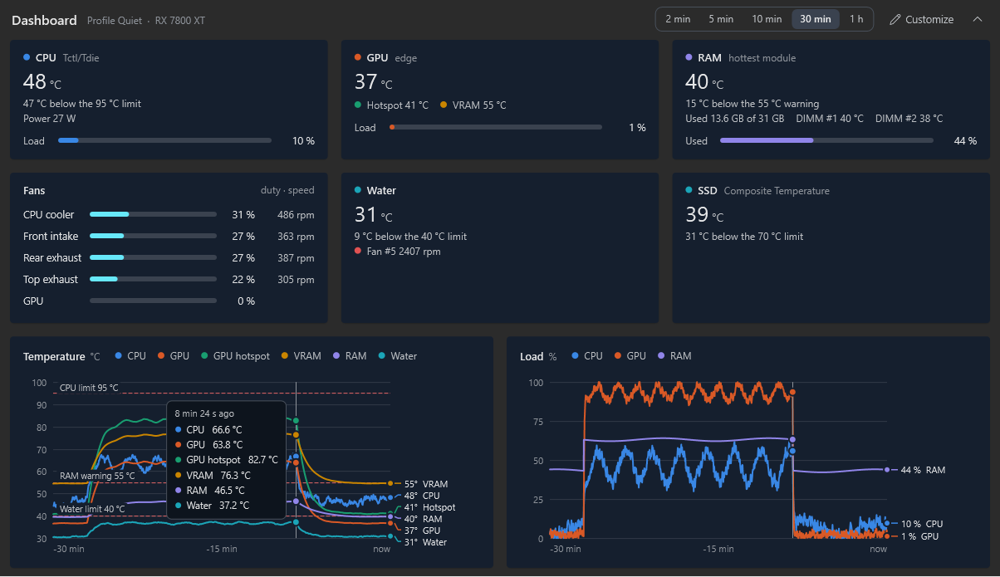
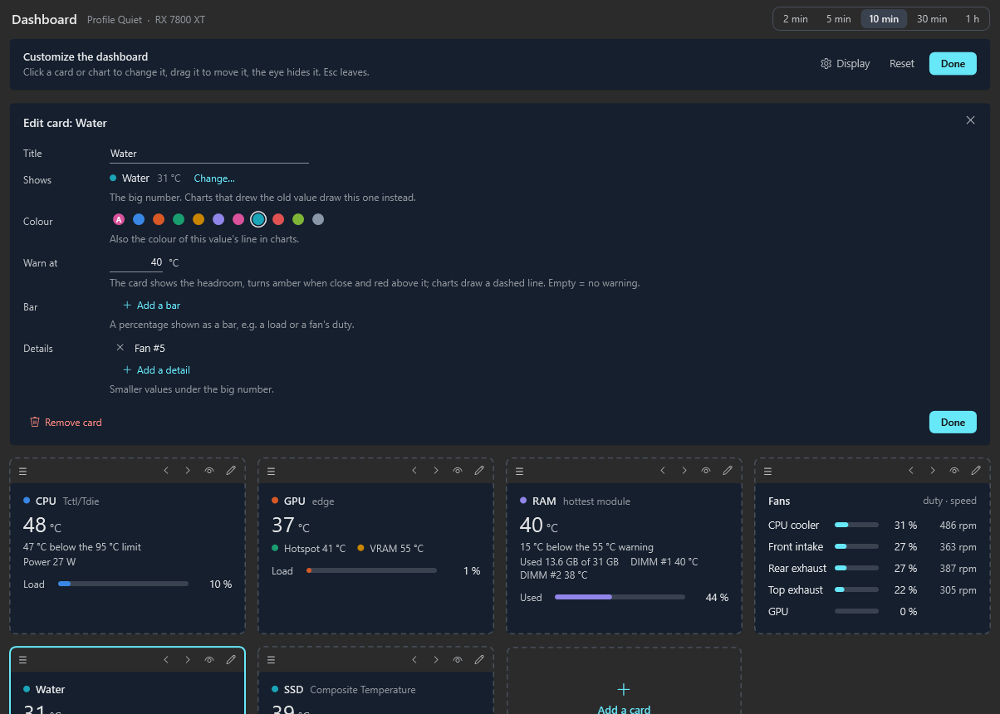
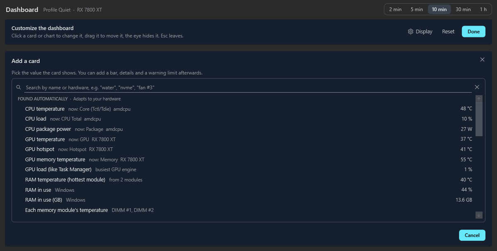
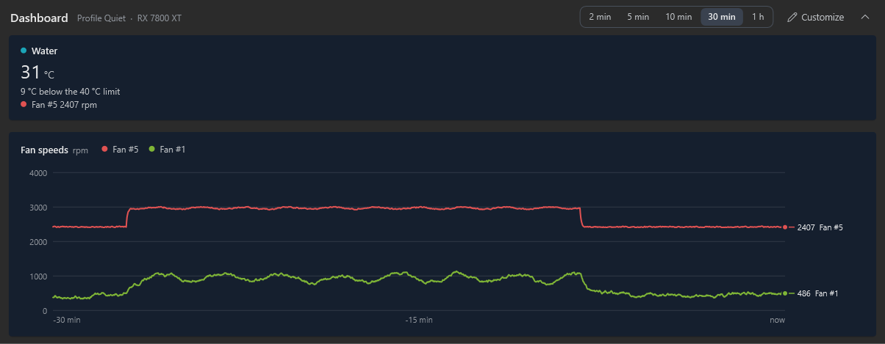
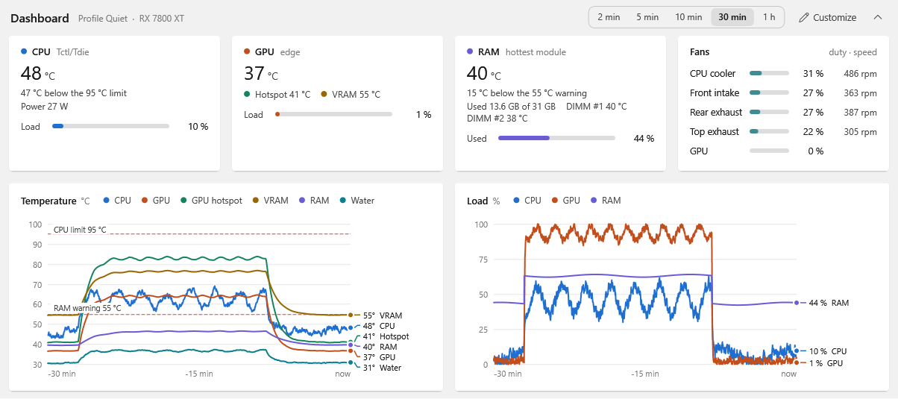

# Fan Control Dashboard

**The dashboard Fan Control never had.** An unofficial plugin that puts live temperatures, loads, fan speeds and
history charts right at the top of [Fan Control](https://getfancontrol.com)'s Home page. It looks like part of the app,
and you can make it show exactly what you care about.



<sub>All screenshots use the demo data of the [harness](#the-harness), not a real machine.</sub>

- **Everything at a glance.** CPU, GPU and RAM temperatures with the headroom to their limits, load, power, every fan's
  duty and speed. Values turn amber when they get close to a limit and red above it.
- **History you can read.** Up to an hour of every value, with charts that stay smooth at any length. A crosshair
  syncs across all charts and the tooltip lists every line. Limit lines and labels on each line show where you stand.
- **Yours to arrange.** Hit **Customize** and change the dashboard right where it is. Add a card for any sensor
  Fan Control knows (a water temperature, an SSD, a pump, a mix sensor, a voltage…), build charts from any sensors,
  reorder by dragging, hide what you don't need.
- **Feels native.** It copies Fan Control's own cards, headers and colours at runtime, follows its light and dark theme
  and switches with it. It fits wide and narrow windows, works with the keyboard and screen readers, and redraws only
  while you look at it.
- **Works on your hardware.** AMD and Intel CPUs; AMD and NVIDIA GPUs; DDR5 modules with sensors, DDR4 without; anything else
  Fan Control can read can be added by hand.
  When something isn't there, the dashboard says so instead of showing zeros.

> [!IMPORTANT]
> This is a community plugin. It is not made by, affiliated with or endorsed by Fan Control or its author (Rem0o).
> It adds itself to Fan Control's window in a way the plugin API does not officially support, so a Fan Control update can
> stop it from appearing. Fan control itself is never affected ([how it works](#how-it-works)).

## Make it yours

Click **Customize** (top right of the dashboard). The dashboard stays where it is and becomes editable: click any card
or chart to change it, drag it by its handle, hide it with the eye, or add new ones.



A **card** shows one big value plus anything you like around it:

| | |
|---|---|
| **Shows** | Any value: the automatically found ones (CPU temperature, GPU hotspot, hottest RAM module, …) or any sensor Fan Control lists. Swapping it also updates the charts that drew the old one. |
| **Warn at** | A limit. The card shows the headroom ("9 °C below the 40 °C limit"), turns amber when close and red above it, and charts draw a dashed line. RAM can use the limit the modules report themselves. |
| **Bar** | Any percentage as a bar: a load, a fan's duty. |
| **Details** | Smaller values under the big one: hotspot and VRAM, package power, every memory module, a pump speed… |
| **Colour** | Shared with the value's line in every chart, so a card and its line always match. |

**Add a card** opens a sensor picker. It lists the values the dashboard finds by itself first, then every sensor
grouped by hardware (CPU, GPU, memory, motherboard, storage, Fan Control's own mix and custom sensors), each with its
**live value**. That way you can tell `Temperature #3` from `Temperature #4` without digging through Fan Control.
Type to search.



**Charts** work the same way: add a chart, then add lines from any sensors that share a unit: temperatures, loads,
fan speeds in rpm, power in watts, clocks, voltages. Every chart scales its own axis.



**Display** (in customize mode) holds the options for the whole dashboard: °C or °F, comfortable or compact density,
charts side by side or stacked, chart height, line smoothing and limit lines. The header switches the history between
2, 5, 10 and 30 minutes and 1 hour. Click a legend entry to hide a line. **Reset** brings back the default layout.

| Light theme | Collapsed |
|---|---|
|  |  |

Collapsed (the chevron in the header), the dashboard takes one line and still shows every card's main value.

## Install

1. Download `FanControl.Dashboard-vX.Y.Z.zip` from the [latest release](../../releases/latest) and unzip it.
2. Right-click `Install-Dashboard.ps1` → **Run with PowerShell**, or in a terminal:

   ```powershell
   powershell -ExecutionPolicy Bypass -File .\Install-Dashboard.ps1
   ```

   The script asks for administrator rights once (Fan Control's `Plugins` folder is under Program Files). It closes
   Fan Control, copies the plugin, unblocks it and starts Fan Control again. While Fan Control is closed (a few seconds),
   your fans follow the BIOS/firmware settings, as they always do when Fan Control is not running.
   If Fan Control is not running and not installed in `C:\Program Files (x86)\FanControl`, add `-FanControlDir "D:\Apps\FanControl"`.

**Manual install**: close Fan Control (tray icon → Exit), copy `FanControl.Dashboard.dll` into Fan Control's `Plugins`
folder, right-click the DLL → Properties → tick **Unblock** if shown, and start Fan Control.

### Uninstall

```powershell
powershell -ExecutionPolicy Bypass -File .\Uninstall-Dashboard.ps1            # keeps your dashboard layout
powershell -ExecutionPolicy Bypass -File .\Uninstall-Dashboard.ps1 -RemoveSettings
```

Or by hand: close Fan Control, delete `Plugins\FanControl.Dashboard.dll` in Fan Control's folder, start Fan Control.
Your layout is stored in `%AppData%\FanControl.Dashboard\settings.json`.

## Compatibility

| | |
|---|---|
| Fan Control | **V285**, both builds: **.NET Framework 4.8** (`FanControl_285_net_4_8`) and **.NET 10** (`FanControl_285_net_10_0`). One DLL works in both; every build is tested against both in CI. |
| Windows | Windows 10 and 11, x64 |
| Hardware | Whatever Fan Control can read. Automatic values are tested with AMD and Intel CPUs; AMD (ADLX and LibreHardwareMonitor) and NVIDIA GPUs; DDR5 module temperatures. Any other sensor can be added by hand. |

Other Fan Control versions may work. The dashboard is inserted into Fan Control's own window, which is not an official
extension point, so any update can change that window. Please [open an issue](../../issues/new/choose) with your
Fan Control version if the dashboard does not appear.

## How it works

- **Values** come from Fan Control itself, through its local IPC (`FanControl.IPC`, the named-pipe service Fan Control
  offers to tools), once per second on a background thread. The automatic values pick sensors by their identifiers and
  names (e.g. `Core (Tctl/Tdie)`, `CPU Package`, `/memory/dimm/N/temperature/0`). GPU load comes from Windows'
  performance counters (like Task Manager) and memory use from Windows. The fan list is read from the active Fan Control profile.
- **The view** is a WPF element the plugin inserts into Fan Control's window. It finds the page of type `HomePage` and its
  panel named `MainPanel`, and copies the style of an existing card and section header. **This is not an official API.**
  If an update changes that page, the dashboard simply does not appear and a line is written to Fan Control's `log.txt`
  (prefix `[Dashboard]`); sensors and fan control keep working. All dashboard code is wrapped so that a failure in it
  cannot take Fan Control down.
- **History** keeps one hour per value (14 KB each) and survives restarts: it is saved every 5 minutes and when
  Fan Control closes (`%AppData%\FanControl.Dashboard\history.bin`), and restored with a gap for the time Fan Control was not running.
- **Cost**: it redraws only while someone can see it (window visible, not minimized, keyboard or mouse used in the last
  2 minutes), and charts draw at most about two points per pixel, so an hour of data costs no more to draw than two minutes.
  A safeguard stops all drawing if Fan Control's memory ever grows beyond 2 GB, and Fan Control's `log.txt` gets its memory
  use every 30 minutes (prefix `[Dashboard] memory:`).
- **Sensors for tray icons**: the plugin also offers `CPU load %`, `GPU load %` and `RAM used %` as Fan Control sensors.
  Fan Control lists plugin sensors with its temperature unit, so they read e.g. `37 °C` there; tray icons show the number.

## Building

Requirements: Windows, the [.NET SDK](https://dotnet.microsoft.com/download) 8 or newer (10 for the .NET 10 test run),
and Fan Control V285 installed. The build compiles against Fan Control's assemblies, which may not be redistributed and
are not on NuGet.

```powershell
.\build.ps1                                   # build, test, copy the plugin to dist\
.\build.ps1 -FanControlDir D:\Apps\FanControl # Fan Control somewhere else (or set FANCONTROL_DIR)
dotnet test -p:FanControlNet10Dir=C:\path\to\FanControl_285_net_10_0   # also run everything under .NET 10
```

Without a .NET SDK, `build.ps1` falls back to the C# compiler of Visual Studio / Build Tools (the tests are skipped).
Install your build with `dist\Install-Dashboard.ps1`.

| Path | |
|---|---|
| `src/` | The plugin. `Plugin.cs` (entry point, adding the view), `DashboardView.cs` (cards, charts, customize mode), `Editors.cs` (card, chart and display editors, sensor picker), `Chart.cs`, `Settings.cs` (layout model and its JSON), `Refs.cs` (value references, names, units, hardware groups), `Sampler.cs` (1 Hz sampling over Fan Control's IPC), `SensorMatcher.cs`, `HistoryBuffer.cs`, `Json.cs`, `Theme.cs`, `Controls*.cs`, `Health.cs` (memory watchdog), `Native.cs` |
| `tests/` | xUnit tests for the logic, run under .NET Framework 4.8 and .NET 10, and binding, IPC and lifecycle checks against Fan Control's assemblies |
| `harness/` | Stand-alone host that renders the dashboard to a PNG |
| `tools/FcTool/` | Developer helper: list Fan Control's sensors and profiles over IPC |
| `dist/` | Install and uninstall scripts (the built DLL lands here) |

### The harness

Renders the dashboard without Fan Control's window, from demo data or live sensors:

```powershell
.\bin\Harness.exe --demo full --custom --theme dark --out dash.png      # csc build; dotnet: harness\bin\Release\Harness.exe
.\bin\Harness.exe --demo intel-nvidia --theme light --width 760 --edit --editor card --out picker.png
.\bin\Harness.exe --live --seconds 10 --hover 0.6 --out live.png        # needs Fan Control running
```

Demo scenarios are `full`, `intel-nvidia`, `ddr4`, `no-gpu`, `no-fans`, `hot` and `starting`. The comment at the top of
`harness/Harness.cs` lists every option. CI renders a set of previews for every pull request under both runtimes
(artifact `previews-and-test-results`).

## License and relationship to Fan Control

This plugin is released under the [MIT License](LICENSE).

Fan Control is proprietary software © Rémi Mercier, free for personal, non-commercial use under its own
[license](https://github.com/Rem0o/FanControl.Releases/blob/master/LICENSE), which forbids redistributing any part of it.
This repository therefore contains **no Fan Control files**: you build against your own installation, and CI downloads
the official releases from [Rem0o/FanControl.Releases](https://github.com/Rem0o/FanControl.Releases) at build time
without publishing them. The plugin uses only the documented plugin interface
([plugin wiki](https://github.com/Rem0o/FanControl.Releases/wiki/Plugins)), Fan Control's IPC client library, and
Fan Control's window as it appears at runtime. It does not modify or decompile Fan Control.

Please don't report dashboard problems to Fan Control's author; use this repository's [issues](../../issues).
