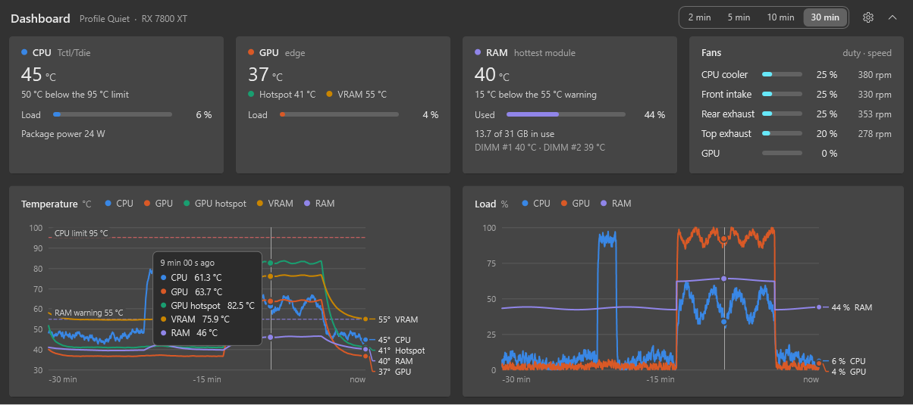
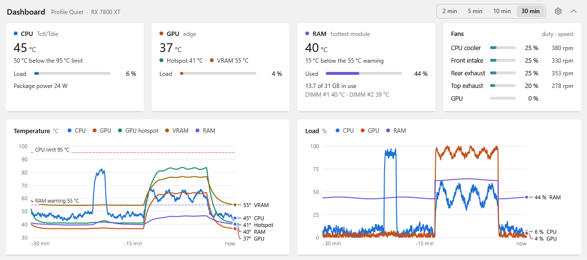
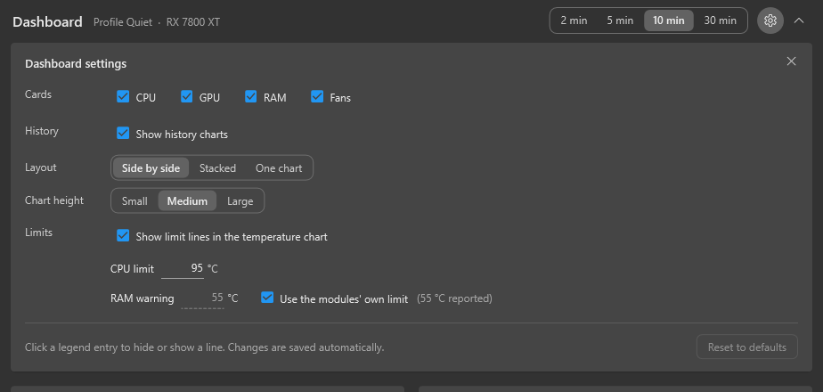

# Fan Control Dashboard

An **unofficial** plugin for [Fan Control](https://getfancontrol.com) that adds a live dashboard to the top of
Fan Control's Home page: temperatures, load and fan speeds at a glance, plus history charts of the last 2 to 30 minutes.



<sub>Screenshots use the built-in demo data of the [harness](#the-harness), not a real machine.</sub>

> [!IMPORTANT]
> This project is not made by, affiliated with or endorsed by Fan Control or its author (Rem0o).
> It hooks into Fan Control's window in a way the plugin API does not officially support, so a Fan Control update
> can stop the dashboard from appearing (see [How it works](#how-it-works)). Fan control itself is never affected.

## Features

- **Cards** for CPU, GPU, RAM and fans, laid out in 4, 2 or 1 columns depending on the window width (never 3 + 1).
  - **CPU**: package temperature with the headroom to your CPU's limit (amber when close, red at or over it), load, package power.
  - **GPU**: temperature, hotspot and memory (VRAM) temperatures, load as Task Manager shows it (busiest engine).
  - **RAM**: hottest memory module (DDR5 modules with a temperature sensor) with the headroom to the modules' own warning
    threshold, amount in use, per-module temperatures. Without module sensors it shows the amount in use instead.
  - **Fans**: duty and speed of every enabled control in the current Fan Control profile; hover a name to see its curve.
- **History charts** for temperature and load: side by side, stacked, or one chart with a toggle; 2 / 5 / 10 / 30 minutes;
  limit lines; a hover crosshair that is synced between the charts; click a legend entry to hide or show a line.
- **Matches Fan Control's look**: cards and headers copy the style of Fan Control's own cards at runtime, in both the light
  and the dark theme, and restyle when you switch themes.
- **Collapsible**: collapsed, the header still shows CPU, GPU and RAM temperatures in one line.
- **Plugin sensors** `CPU load %`, `GPU load %` and `RAM used %`, e.g. for tray icons (see [Known issues](#known-issues)).
- **Keyboard and screen reader friendly**: every control can be reached with Tab and used with Enter/Space (arrow keys in the
  segmented toggles, Esc closes the settings) and is announced as a button.

| Light theme | Collapsed |
|---|---|
|  |  |

## Compatibility

| | |
|---|---|
| Fan Control | **V285** (tested), the **.NET Framework 4.8** build (`FanControl_285_net_4_8`). The .NET 10 build of Fan Control is not supported yet. |
| Windows | Windows 10 and 11, x64 |
| .NET | .NET Framework 4.8 (included in Windows 10 1903+ and Windows 11) |
| Hardware | Whatever Fan Control can read. Tested sensor naming: AMD and Intel CPUs; AMD GPUs (ADLX and LibreHardwareMonitor) and NVIDIA GPUs; DDR5 module temperatures. Missing sensors are shown as such, never as zeros. |

Other Fan Control versions may work, but because the dashboard is inserted into Fan Control's own window
(not an official extension point), any update can change that window. Please [open an issue](../../issues/new/choose)
with your Fan Control version if the dashboard does not appear.

## Install

1. Download `FanControl.Dashboard-vX.Y.Z.zip` from the [latest release](../../releases/latest) and unzip it.
2. Right-click `Install-Dashboard.ps1` → **Run with PowerShell**, or in a terminal:

   ```powershell
   powershell -ExecutionPolicy Bypass -File .\Install-Dashboard.ps1
   ```

   The script asks for administrator rights once (Fan Control's `Plugins` folder is under Program Files), closes
   Fan Control, copies the plugin, unblocks it and starts Fan Control again. While Fan Control is closed (a few seconds),
   your fans follow the BIOS/firmware settings, as they always do when Fan Control is not running.
   Use `-FanControlDir "D:\Apps\FanControl"` if Fan Control is not running and not in `C:\Program Files (x86)\FanControl`.

**Manual install**: close Fan Control (tray icon → Exit), copy `FanControl.Dashboard.dll` into Fan Control's `Plugins`
folder, right-click the DLL → Properties → tick **Unblock** if shown, and start Fan Control.

## Uninstall

```powershell
powershell -ExecutionPolicy Bypass -File .\Uninstall-Dashboard.ps1            # keeps your dashboard settings
powershell -ExecutionPolicy Bypass -File .\Uninstall-Dashboard.ps1 -RemoveSettings
```

Or by hand: close Fan Control, delete `Plugins\FanControl.Dashboard.dll` in Fan Control's folder, start Fan Control.
Settings are in `%AppData%\FanControl.Dashboard\settings.json`.

## Settings

Open them with the gear icon in the dashboard header. Changes apply and save immediately.



| Setting | Default | |
|---|---|---|
| Cards | all on | Which cards to show. |
| History | on | Show the history charts. |
| Layout | Side by side | *Side by side* (one column below about 900 px), *Stacked*, or *One chart* with a Temperature/Load toggle. |
| Chart height | Medium | 160 / 220 / 300 px. |
| History length | 10 min | The 2 / 5 / 10 / 30 min toggle in the header. History is kept for 30 minutes in memory. |
| Show limit lines | on | Dashed lines for the CPU limit and the RAM warning in the temperature chart. |
| CPU limit | 95 °C | Set it to your CPU's maximum temperature (Tjmax): about 95 °C for AMD Ryzen 7000/9000, 89 °C for Ryzen X3D models, 100 °C for most Intel desktop CPUs. Used for the headroom text and the limit line. |
| RAM warning | 55 °C, *use the modules' own limit* on | DDR5 modules report a "high" threshold themselves (usually 55 °C); with the option on it is used when available. Hidden when your modules report no temperature. |
| Hidden lines | none | Click a legend entry to hide or show a line; remembered per chart type. |

**Reset to defaults** restores everything. To start over completely, delete `%AppData%\FanControl.Dashboard\settings.json`.

## How it works

- **Sensors**: the plugin reads values through Fan Control's own IPC (`FanControl.IPC`, the named-pipe gRPC service Fan Control
  exposes for tools), once per second on a background thread. It picks sensors by their identifiers and names
  (e.g. `Core (Tctl/Tdie)`, `CPU Package`, `/memory/dimm/N/temperature/0`). GPU load comes from Windows performance counters
  (`GPU Engine`, like Task Manager), memory use from `GlobalMemoryStatusEx`. The fan list comes from the active Fan Control profile.
- **UI**: Fan Control's plugin API (`IPlugin2`) only provides sensors and controls. The dashboard is a WPF element that the
  plugin inserts into Fan Control's window: it finds the page of type `HomePage` and its panel named `MainPanel`, and copies
  the style of an existing `Card` and section header so it looks native. **This is not an official API.** If a Fan Control
  update renames or restructures that page, the dashboard simply does not appear and a line is written to Fan Control's
  `log.txt` (prefix `[Dashboard]`); sensors and fan control keep working. All UI code is wrapped so that a failure in the
  dashboard cannot take Fan Control down.
- **Resources**: the view only redraws while someone can see it (on screen, window not minimized, keyboard or mouse input
  in the last 2 minutes). History keeps recording in the background (8 series × 1800 samples).

## Known issues

- **Out-of-memory investigation (open).** On the author's PC, Fan Control crashed twice with an `OutOfMemoryException`
  in WPF's render thread (process commit around 58 GB) while the dashboard was installed. It could not be reproduced on
  demand and the root cause is **not confirmed**; it is not known whether the dashboard causes it. As mitigation and to
  collect evidence, the dashboard only draws while it is visible and you were active in the last 2 minutes, and a memory
  watchdog logs Fan Control's private memory every 30 minutes to `log.txt` and stops all dashboard drawing for the rest of
  the session if the process grows beyond 2 GB (logging whether growth continues without the dashboard drawing).
  If you see this crash or `[Dashboard] memory:` lines with growing numbers in Fan Control's `log.txt`, please
  [report it](../../issues/new?template=bug_report.yml) with those log lines.
- **Load sensors show °C.** Fan Control lists plugin sensors as temperatures, so `CPU load %` shows as e.g. `37 °C`
  in Fan Control's sensor lists; tray icons show only the number.
- **History starts empty** after every Fan Control restart (it is kept in memory only).
- **English only**, and temperatures are always shown in °C.
- **.NET 10 build of Fan Control** is not supported yet (the plugin uses `System.Web.Extensions` for JSON, which only exists in .NET Framework).

## Building

Requirements: Windows, the [.NET SDK](https://dotnet.microsoft.com/download) (8 or newer) and Fan Control V285 installed
(the build compiles against Fan Control's assemblies, which may not be redistributed and are not on NuGet).

```powershell
.\build.ps1                                   # build, test, copy the plugin to dist\
.\build.ps1 -FanControlDir D:\Apps\FanControl # Fan Control somewhere else (or set FANCONTROL_DIR)
dotnet build -p:FanControlDir="D:\Apps\FanControl"
dotnet test
```

Without a .NET SDK, `build.ps1` falls back to the C# compiler of Visual Studio / Build Tools (tests are skipped).
Then install your build with `dist\Install-Dashboard.ps1`.

| Path | |
|---|---|
| `src/` | The plugin: `Plugin.cs` (entry point, UI injection), `Sampler.cs` (1 Hz sampling over Fan Control's IPC), `SensorMatcher.cs`, `HistoryBuffer.cs`, `Settings.cs`, `DashboardView.cs`, `Chart.cs`, `Controls.cs`, `Theme.cs`, `Health.cs` (memory watchdog), `Native.cs` (CPU/RAM/GPU counters) |
| `tests/` | xUnit tests for the pure logic: settings, ring buffer, sensor matching, column layout, fan list parsing |
| `harness/` | Stand-alone host that renders the dashboard to a PNG |
| `tools/FcTool/` | Developer helper: list Fan Control's sensors and profiles over IPC |
| `dist/` | Install and uninstall scripts (the built DLL lands here) |

### The harness

Renders the dashboard without Fan Control's window, with demo data or live sensors:

```powershell
.\bin\Harness.exe --demo full --theme dark --out dash.png            # csc build; dotnet build: harness\bin\Release\Harness.exe
.\bin\Harness.exe --demo intel-nvidia --theme light --width 760 --settings --out narrow.png
.\bin\Harness.exe --live --seconds 10 --hover 0.6 --out live.png     # needs Fan Control running
```

Scenarios: `full`, `intel-nvidia`, `ddr4`, `no-gpu`, `no-fans`, `hot`, `starting`. Run it without arguments for all options
(see the comment at the top of `harness/Harness.cs`). CI renders a set of previews for every pull request (artifact
`previews-and-test-results`).

## License and relationship to Fan Control

This plugin is released under the [MIT License](LICENSE).

Fan Control is proprietary software © Rémi Mercier, free for personal, non-commercial use under its own
[license](https://github.com/Rem0o/FanControl.Releases/blob/master/LICENSE), which forbids redistributing any part of it.
This repository therefore contains **no Fan Control files**: you build against your own installation, and CI downloads the
official release from [Rem0o/FanControl.Releases](https://github.com/Rem0o/FanControl.Releases) at build time without
publishing it. The plugin uses only the documented plugin interface ([plugin wiki](https://github.com/Rem0o/FanControl.Releases/wiki/Plugins)),
Fan Control's IPC client library, and Fan Control's window as it appears at runtime; it does not modify or decompile Fan Control.

Please do not report dashboard problems to Fan Control's author; use this repository's [issues](../../issues).
